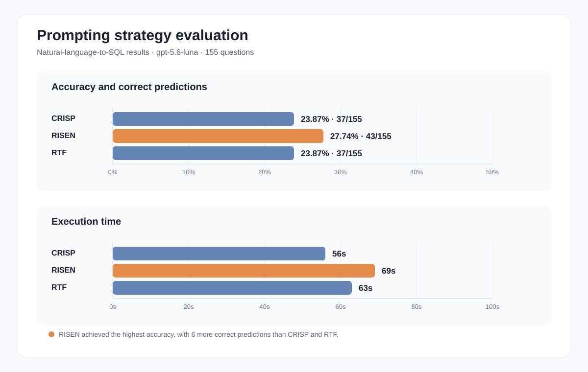

# CRISP

Model: gpt-5.6-luna
Inference time: 56s
Accuracy: 0.2387 (23.87%)
Correct: 37/155

# RISEN

Model: gpt-5.6-luna
Inference time: 69s
Accuracy: 0.2774 (27.74%)
Correct: 43/155

# RTF

Model: gpt-5.6-luna
Inference time: 63s
Accuracy: 0.2387 (23.87%)
Correct: 37/155

## Visualization

