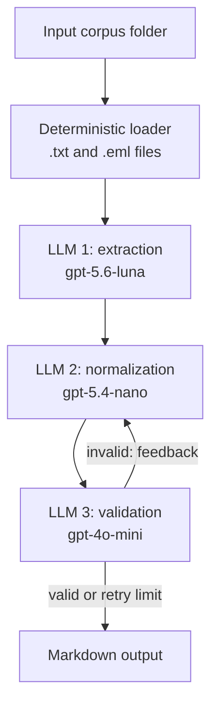

# Agentic Requirements Refinement Network

This project converts a heterogeneous corpus of software-related documents
into one structured, traceable requirements document. The input may contain
plain-text drafts, interview transcripts, meeting minutes, and email
conversations.

## Architecture

The network is implemented in
`agentic_requirements.py` using LangGraph:



### Nodes and their design rationale

1. **Document loader**: This is a natural deterministic node because it does
   not require interpretation. It recursively traverses the supplied folder,
   reads non-empty `.txt` and `.eml` files, assigns stable relative document
   IDs, and combines the documents into a consistent format for downstream
   processing. It rejects an invalid input directory and fails explicitly when
   no supported documents are found.
2. **Requirement extractor**: The extractor identifies candidate functional and
   non-functional requirements while preserving source IDs and evidence quotes.
   It is separate from normalization so that extraction can prioritize recall
   and faithful evidence preservation. It deliberately does not deduplicate:
   merging at this stage could hide separate pieces of evidence or cause an
   ambiguous interpretation to erase a potentially important candidate.
3. **Requirement normalizer**: The normalizer transforms the candidates into a
   consistent requirements set. It merges semantic duplicates, assigns stable
   `REQ-###` identifiers, standardizes terminology, preserves the priorities
   extracted from the candidates, and records discarded candidates with
   reasons and sources. It also performs the revised runs shown in the
   diagram. When validation fails, the validator's problems, missing topics,
   and contradictions are injected into an additional prompt, and the same
   normalizer is run again rather than introducing a separate revision node. At
   most two revised runs are allowed.
4. **Requirement validator**: Validation is an independent node so that the
   model checking the result is not simply relying on the same transformation
   that produced it. It checks traceability, completeness, unique IDs,
   duplicate removal, consistency, required fields, and the discarded-candidate
   reasons against the original document IDs. It returns structured feedback:
   a validity flag, concrete problems, missing topics, and contradictory
   requirements. If the result is invalid, that feedback is sent back to the
   normalizer; if it is valid or the retry limit is reached, processing
   continues to rendering.
5. **Renderer**: The renderer is deterministic because the final output should
   have a predictable structure rather than depend on another model call. It
   creates the Markdown priority-scale explanation, requirement headings,
   source lists, evidence quotes, and discarded-requirements section.

## Design Considerations

### Structured data models

Pydantic models constrain the data exchanged with the LLM nodes. Separate
models represent extracted candidates, normalized requirements, discarded
candidates, and validation results. This makes required fields and allowed
priority values explicit, while allowing the graph state to carry structured
feedback between nodes.

### Model selection

The model assignments are provisional and were not selected through a
comparative evaluation. The main design decision is to separate extraction,
normalization, and validation; the specific models should be validated later
against quality, cost, and latency requirements.

## Usage

Set `OPENAI_API_KEY` in a local `.env` file, then run the script from the task
directory. Provide the corpus directory as the positional input and choose the
output Markdown path with `--output`:

```bash
python agentic_requirements.py data/corpus \
  --output requirements_document.md
```
